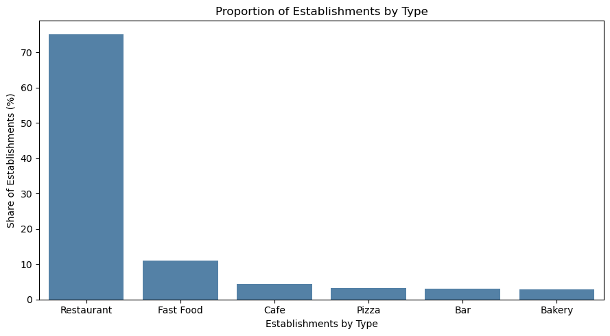

# Los Angeles Restaurant Market Analysis

An exploratory market study to inform the concept, seating capacity, and location research for a café with robot waiters.

## Business question

What do the observed establishment mix, chain presence, seating capacity, and street concentrations suggest for a small café pilot?

## Key findings

| Metric | Result |
|---|---:|
| Establishments after data preparation | 9,648 |
| Restaurant category's share | 75.18% |
| Non-chain establishments | 61.90% |
| Cafés belonging to a chain | 61.15% |
| Average café seating capacity | 25 seats |
| Largest street count: Wilshire Blvd | 357 establishments |



**Recommendation:** Explore a compact café pilot of approximately 25 seats, using the observed café average as a starting benchmark. Compare specific sites on pedestrian traffic, rent, target audience, and nearby competition before selecting a location. Validate demand, robot operating costs, service quality, and unit economics before expanding.

## Analysis

- Inspect missing values, duplicate rows, identifiers, and data types.
- Compare establishment categories and chain prevalence within each category.
- Examine matching establishment names and their average seating capacity.
- Extract street labels from addresses and identify the ten highest-count streets.
- Examine seating distributions on those streets and formulate a pilot recommendation.

[Read the executed notebook](analysis.ipynb) · [View seating distributions](seat_distribution_top_10_streets.png)

**Tools:** Python, Pandas, Matplotlib, Seaborn, Jupyter.

## What the data can and cannot tell us

- This is an educational dataset, not a verified current census of Los Angeles businesses. The data collection date and coverage are not established here.
- Street counts include all establishment categories. They are counts, not density per unit of street length or measures of customer demand.
- Address extraction is heuristic. One address remains flagged for manual review; spelling and directional variants may affect grouping. The 767 labels with one establishment are not independently verified physical streets.
- Exact establishment-name matches are a proxy for chain grouping. Different spellings can split one brand; chain sizes are not independently verified.
- The dataset contains no robot-service performance, revenue, rent, or customer-demand measures. Neither a 25-seat benchmark nor the prevalence of chain cafés demonstrates commercial viability.

## Reproduce the analysis

1. Download the linked source CSV and place it in `data/rest_data_us_upd.csv`; see [dataset documentation](DATA.md).
2. Install dependencies in a Python environment:

```bash
pip install -r requirements.txt
jupyter lab
```

3. Open `analysis.ipynb` from the repository directory and run all cells.

## Provenance and validation

Analysis by Gabriella Ferraz Gomes, developed during the TripleTen Data Analytics bootcamp. The portfolio edition preserves the analytical approach while correcting chart labels, the address diagnostic, table-of-contents anchors, and interpretation limitations.

All 38 code cells were executed in order in a fresh Python 3.13 Jupyter kernel using the linked CSV. No cell execution errors occurred. Headline values, missing-value handling, and regenerated charts were checked. Package versions are recorded in `requirements.txt`.
